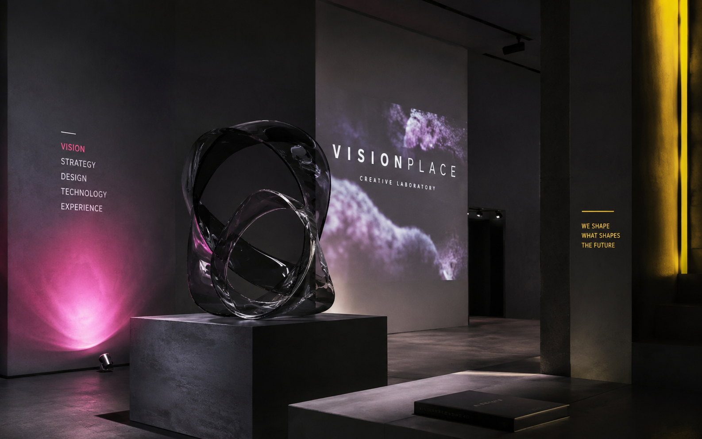

# VISIONPLACE

### Branding · Digital Design · Creative Direction

Сайт незалежної креативної агенції: від стратегії бренду й візуальної айдентики до цифрових продуктів, кампаній та артдирекції. Англомовна презентація студії поєднує портфоліо, інтерактивні візуальні експерименти та опис процесу роботи.

**[Переглянути сайт →](https://0darkdante.github.io/visionplace-site/)**



## Що є на сайті

- **Портфоліо:** три візуальні світи — NOIR, ORBIT і FABLE.
- **Vision mode:** інтерактивний повзунок, який змінює вигляд головної композиції.
- **Порівняння до / після:** перегляд трансформації бренду за допомогою повзунка.
- **Послуги:** акордеон із напрямами роботи агенції.
- **Процес і студія:** етапи роботи, команда та візуальні матеріали.
- **Навігація:** повноекранне меню з прев’ю зображень.
- **Анімації:** поява блоків під час прокручування, кінетична типографіка, інтерактивний курсор і реакції елементів на наведення.
- **Запит на проєкт:** модальне вікно з перевіркою полів і повідомленням про завершення.
- **Приватність:** окремі сторінки Privacy Policy та Cookie Policy, банер вибору cookies.

Анімації враховують системне налаштування `prefers-reduced-motion`; частина ефектів курсора вимикається на пристроях із сенсорним керуванням.

## Технології

**HTML5 · CSS3 · JavaScript · GitHub Pages**

Сайт працює без фреймворків, npm-залежностей і кроку збірки. Зображення зберігаються в репозиторії; шрифти Inter та Syne підключені через Google Fonts.

## Структура

```text
visionplace-site/
├── index.html          # Головна сторінка агенції
├── privacy.html        # Політика конфіденційності
├── cookies.html        # Політика cookies
├── assets/
│   ├── styles.css      # Адаптивні стилі та анімації
│   ├── script.js       # Інтерактивність сайту
│   └── images/         # Портфоліо, студія та візуальні матеріали
├── favicon.svg
├── robots.txt
├── sitemap.xml
└── .nojekyll           # Публікація статичних файлів без Jekyll
```

## Локальний запуск

```bash
git clone https://github.com/0DarkDante/visionplace-site.git
cd visionplace-site
```

Відкрийте `index.html` через **Live Server** у VS Code. Або, якщо встановлено Python 3, запустіть локальний сервер:

```bash
python3 -m http.server 8000
```

Сайт буде доступний за адресою [localhost:8000](http://localhost:8000).

## Форма та зберігання даних

Форма запиту працює як демонстрація: перевіряє введені дані, зберігає останній запит у `sessionStorage` під ключем `visionplace:lastEnquiry` і показує підтвердження. Дані не надсилаються на сервер або електронну пошту.

Вибір у банері cookies зберігається в `localStorage` під ключем `visionplace:cookiePreference`. Поточна реалізація не підключає аналітичні чи рекламні скрипти.

## Публікація

GitHub Pages публікує сайт із **кореня гілки `main`**. Для оновлення достатньо завантажити зміни:

```bash
git add .
git commit -m "Update website"
git push
```

**Адреса сайту:** https://0darkdante.github.io/visionplace-site/

SEO-посилання й карта сайту містять домен `visionplace.site`. Підключення власного домену налаштовується окремо в GitHub Pages.
